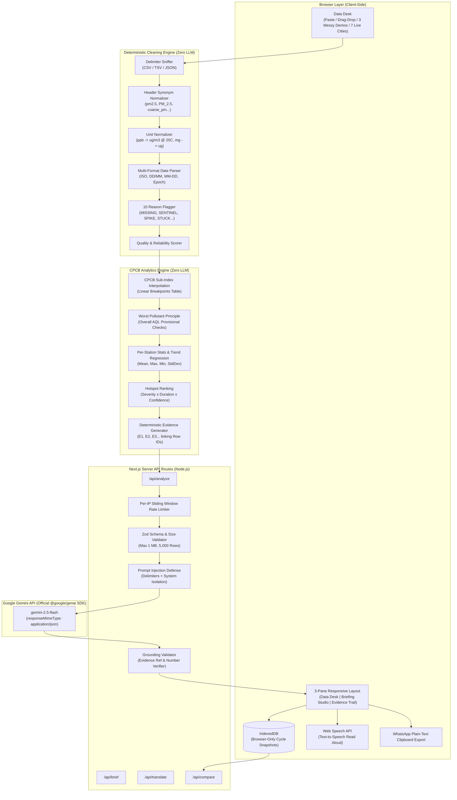
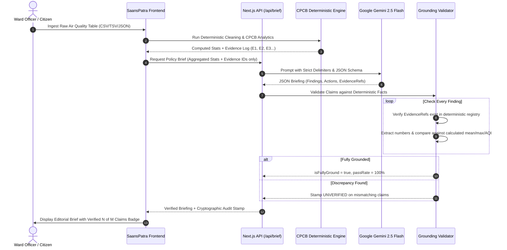

# SaansPatra (सांसपत्र) – Civic Air Quality Briefing Studio

[](https://nextjs.org/)
[](https://www.typescriptlang.org/)
[](https://ai.google.dev/)
[](https://tailwindcss.com/)
[](https://vitest.dev/)
[](https://playwright.dev/)
[](https://cpcb.nic.in/)

> **Google for Developers PromptWars Hackathon Submission**  
> An authoritative, AI-driven civic intelligence tool transforming raw, chaotic air quality data into deterministically grounded, persona-prioritized municipal interventions and multi-lingual citizen advisories.

---

## 1. Chosen Vertical & Problem Alignment

### Why Air Quality & Civic Governance?
Air pollution across the Indo-Gangetic Plains and Indian metropolitan corridors (Delhi-NCR, Mumbai, Kolkata, Lucknow, Patna, Bengaluru, Bhopal) is a public health emergency. Municipal ward officers, Resident Welfare Associations (RWAs), and school administrators receive or collect raw continuous ambient air quality monitoring (CAAQMS) tables from CPCB, SPCB, and low-cost sensor networks.

However, raw monitoring data is routinely plagued by:
- **Chaotic units**: $\text{PM}_{2.5}$ in $\mu\text{g/m}^3$, $\text{PM}_{10}$ in $\text{mg/m}^3$, $\text{NO}_2$ in $\text{ppb}$, and $\text{CO}$ in $\text{mg/m}^3$.
- **Data corruption**: Sentinel values (`-999`, `-1`, `9999`), missing fields (`NA`, `--`, null), and stuck sensors (repetitive identical measurements from frozen telemetry).
- **Date format chaos**: Mixed ISO 8601, Indian `DD/MM/YYYY`, US `MM-DD-YYYY`, and epoch timestamps within the same table.
- **Cognitive overload**: Ward officers cannot decipher raw tables into enforcement actions (road dust sweeping, garbage burning crackdowns, DG set regulation) before peak morning exposure hours.
- **Communication barrier**: Citizens and vulnerable populations (children, senior citizens, respiratory patients) need clear, jargon-free guidance in their mother tongue at appropriate reading levels—not numbers alone.

**SaansPatra** bridges this critical last-mile gap:
1. **Deterministic Cleaning Engine (Zero LLM)**: Sniffs delimiters, normalizes synonyms and units, flags 10 distinct error reasons, and computes reliability scores per station without wasting LLM tokens.
2. **CPCB Analytics Engine (Zero LLM)**: Calculates official Indian National Air Quality Index (AQI) sub-indices via linear interpolation and flags provisional ratings when fewer than 3 pollutants or particulate matter are missing. Generates unique Evidence IDs ($E_1, E_2, \dots$) for complete traceability.
3. **Structured Gemini Intelligence**: Sends *only* compact aggregated metrics and evidence IDs to `gemini-2.5-flash` using structured JSON output.
4. **Grounding Validator**: Cross-checks every AI claim, verifying cited evidence refs and confirming that numbers match computed facts. Flags ungrounded claims with an `UNVERIFIED` stamp.
5. **Persona Engine**: Prioritizes enforcement actions for Ward Officers, residential actions for RWAs, student protective protocols for Schools, and health advisories for Citizens.
6. **Cycle Comparison (IndexedDB)**: Computes deterministic deltas between monitoring cycles with AI narration of "what changed", carrying over action checklist statuses across GrAP cycles.
7. **Multi-Lingual Citizen Advisory**: Generates localized public health notices across 6 languages (English, Hindi, Marathi, Bengali, Tamil, Telugu) and 3 reading levels (Class-5 Simple, General Citizen, Technical Brief), with one-click WhatsApp sharing and Web Speech API audio.
8. **Real-Time City Ingestion & Offline Resilience**: Ingests live telemetry from Open-Meteo for 7 Indian cities with zero API keys required, backed by pre-cached seasonal fallbacks for 100% offline uptime.

---

## 2. Architecture & Data Flow



---

## 3. Zero-Hallucination Grounding Validator

Every number and station cited in the briefing must be traceable to the underlying monitoring records. The diagram below shows the verification sequence:



---

## 4. CPCB National Air Quality Index (NAQI) Standards

SaansPatra implements the official Central Pollution Control Board (CPCB) India piecewise linear sub-index formula:

$$I_p = \left[ \frac{I_{HI} - I_{LO}}{B_{HI} - B_{LO}} \right] \times (C_p - B_{LO}) + I_{LO}$$

Where:
- $I_p$: Computed sub-index for pollutant $p$
- $C_p$: Measured 24-hour concentration
- $B_{HI}, B_{LO}$: Concentration breakpoints corresponding to the category band
- $I_{HI}, I_{LO}$: AQI index limits for the corresponding category band

### CPCB 6-Tier Category Breakpoints

| Category | AQI Range | $\text{PM}_{2.5}$ ($\mu\text{g/m}^3$) | $\text{PM}_{10}$ ($\mu\text{g/m}^3$) | $\text{NO}_2$ ($\mu\text{g/m}^3$) | $\text{SO}_2$ ($\mu\text{g/m}^3$) | $\text{CO}$ ($\text{mg/m}^3$) | $\text{O}_3$ ($\mu\text{g/m}^3$) |
|---|---|---|---|---|---|---|---|
| **Good** | 0–50 | 0–30 | 0–50 | 0–40 | 0–40 | 0–1.0 | 0–50 |
| **Satisfactory** | 51–100 | 31–60 | 51–100 | 41–80 | 41–80 | 1.1–2.0 | 51–100 |
| **Moderate** | 101–200 | 61–90 | 101–250 | 81–180 | 81–380 | 2.1–10.0 | 101–168 |
| **Poor** | 201–300 | 91–120 | 251–350 | 181–280 | 381–800 | 10.1–17.0 | 169–208 |
| **Very Poor** | 301–400 | 121–250 | 351–430 | 281–400 | 801–1600 | 17.1–34.0 | 209–748 |
| **Severe** | 401–500 | 250+ | 430+ | 400+ | 1600+ | 34.0+ | 748+ |

**Core Scientific Guards**:
- **Worst Pollutant Rule**: Overall station AQI equals $\max(I_p)$ across monitored pollutants.
- **Provisional Guard**: If valid readings exist for fewer than 3 pollutants or missing particulate matter ($\text{PM}_{2.5}$ or $\text{PM}_{10}$), the index is explicitly classified as **`PROVISIONAL`** with low confidence.

---

## 5. Deterministic Anomaly Forensics Matrix

Without running LLMs on raw rows, the deterministic engine flags 10 distinct failure modes:

| Reason Code | Trigger Condition | Real-World Civic Implication |
|---|---|---|
| `MISSING` | Cell is null, empty string, or whitespace | Data drop from sensor packet loss |
| `SENTINEL` | Value in `[-999, -99, 9999, -1]` | Hardware maintenance or calibration code |
| `NEGATIVE` | Concentration $< 0$ | Optical baseline zero-drift in light scatter sensor |
| `OUT_OF_RANGE` | $\text{PM}_{2.5} > 1000$ or $\text{CO} > 100$ | Physical limit exceeded; potential sensor blowout |
| `STUCK_SENSOR` | $\ge 5$ consecutive identical measurements | Telemetry transmission freeze or pump failure |
| `SPIKE` | Sudden $> 3\times$ jump over rolling median | Localized point-source blast or dust resuspension |
| `DUPLICATE` | Identical station name and timestamp | Duplicate telemetry ingestion packet |
| `UNIT_AMBIGUOUS` | Unrecognized unit annotation | Prevents catastrophic unit scaling miscalculations |
| `TIME_GAP` | Telemetry gap $> 6$ hours | Network downtime during critical exposure window |
| `BAD_DATE` | Unparseable or future timestamp | System clock desynchronization on data logger |

---

## 6. Built-in Benchmark Datasets & Live City Telemetry

Judges can explore realistic Indian air quality data across two modes:

### Benchmark Scenarios
1. **Delhi NCR Multi-Station**: 5 CAAQMS stations (Anand Vihar, ITO, Mandir Marg, RK Puram, Dwarka Sec-8) experiencing winter smog inversion with mixed units (`mg/m3`, `ug/m3`, `ppb`), `-999` sentinels, and missing rows.
2. **Mumbai Coastal & MMR**: Stations (Bandra Kurla, Worli, Powai, Chembur, Borivali East) exhibiting coastal humidity dynamics, Powai PM2.5 stuck sensor flatline (7 consecutive readings at 85.3 $\mu\text{g/m}^3$), and BKC duplicate rows.
3. **Kolkata Metropolitan Area**: TSV format with extreme date format chaos (ISO 8601, `DD/MM/YYYY`, `MM-DD-YYYY`, `DD-Mon-YY`, epoch timestamps) and negative sensor noise.

### Zero-Auth Live Multi-City Telemetry
Ingests live hourly telemetry from Open-Meteo Air Quality API for 7 major Indian hubs, with pre-cached fallbacks for 100% offline uptime:
- **New Delhi** (Anand Vihar / DPCC CAAQMS)
- **Bhopal** (Paryavaran Parisar / MPPCB CAAQMS)
- **Mumbai** (Bandra Kurla Complex / MPCB CAAQMS)
- **Bengaluru** (BTM Layout / KSPCB CAAQMS)
- **Kolkata** (Jadavpur / WBPCB CAAQMS)
- **Lucknow** (Talkatora Industrial / UPPCB CAAQMS)
- **Patna** (Samanpura / BSPCB CAAQMS)

---

## 7. Persona Engine & Action Matrix

The deterministic analytics are filtered through targeted operational lenses:

| Persona | Operational Priority | Example Directives |
|---|---|---|
| **Ward Officer** | Enforcement & Municipal Operations | Deploy mechanical sweepers & anti-smog guns on Ring Road corridor; flying squad patrols to halt open waste burning; dust netting enforcement on Tier-1 construction. |
| **Housing Society / RWA** | Community Shielding & Emission Control | Ban commercial diesel generator (DG) set operation; provide electric room heaters to night security guards to eliminate open waste fires; seal common-area ventilation during peak inversions. |
| **School Administration** | Student Safety & Exposure Reduction | Suspend morning outdoor assemblies and athletic activities; mandate indoor physical education; recommend pediatric N95 masks for bus transit during morning inversion hours. |
| **Citizen Advisory** | Public Health & Symptom Mitigation | Avoid morning walks before 11:00 AM; keep emergency inhalers readily accessible; cross-ventilate homes only during sunny afternoon hours. |

---

## 8. Multi-Lingual Citizen Advisory & Accessibility

- **6 Indian Languages**: English, Hindi (हिन्दी), Marathi (मराठी), Bengali (বাংলা), Tamil (தமிழ்), Telugu (తెలుగు).
- **3 Reading Levels**:
  1. *Class-5 Simple*: Jargon-free language designed for young students and primary-school reading comprehension.
  2. *General Citizen*: Standard public health guidance for daily routines.
  3. *Technical Brief*: In-depth metrics, microgram concentrations, and meteorological inversion dynamics.
- **Vulnerable Group Cards**: Dedicated, medically reviewed guidance cards for Children, Senior Citizens (60+), and Asthma/Respiratory Patients.
- **One-Click WhatsApp Broadcast**: Formatted message with bullet points, timestamps, and Web Share API integration.
- **Web Speech API Audio Broadcaster**: In-browser text-to-speech with localized Indian voice mapping (`hi-IN`, `mr-IN`, `bn-IN`, etc.) and animated broadcast waveform.
- **Medical Disclaimer**: Clear statutory notice that guidance does not constitute formal medical diagnosis.

---

## 9. Security Architecture

1. **Prompt Injection Hardening**: User data is quarantined within delimiter blocks (`<<<RAW_SUMMARY>>>`) and instructed to ignore embedded commands. System instructions enforce structured JSON output exclusively.
2. **Formula Injection Sanitization**: All exported CSV rows prepend `'` to cells beginning with `=`, `+`, `-`, `@`, or `\t` to prevent DDE code execution in Microsoft Excel.
3. **Server-Side API Key Isolation**: `GEMINI_API_KEY` is loaded exclusively in Node.js server routes and never exposed to the client bundle.
4. **Sliding-Window Rate Limiter**: In-memory IP rate limiter restricts abuse (60 requests/minute on standard endpoints; 20 requests/minute on LLM generation).
5. **Strict Content Security Policy (CSP)**: `default-src 'self'`, script and frame sandboxing, and disallowed external script injection.
6. **Browser-Isolated IndexedDB**: Snapshots for historical period comparisons are stored strictly in client IndexedDB (`saanspatra-db`), ensuring sensitive municipal tables never persist on external servers.
7. **Zero-API-Key Offline Mode**: If `GEMINI_API_KEY` is unset or quota is exhausted, the app switches to an offline deterministic template engine so the demo never fails.

---

## 10. Repository Structure

```
saanspatra/
├── .github/
│   └── workflows/
│       └── ci.yml               # GitHub Actions CI: lint, typecheck, test, build
├── public/
│   ├── saanspatra-emblem.svg    # Official Civic Emblem
│   ├── cpcb-scale-legend.svg    # CPCB 6-Tier Visual Scale
│   └── og-banner.svg            # OpenGraph Social Card
├── src/
│   ├── app/
│   │   ├── api/
│   │   │   ├── analyze/route.ts # Deterministic Analytics API
│   │   │   ├── brief/route.ts   # Gemini Briefing API
│   │   │   ├── compare/route.ts # Period Comparison Diff API
│   │   │   └── translate/route.ts # Multi-Lingual Advisory API
│   │   ├── globals.css          # Editorial Parchment & Atmospheric Command Tokens
│   │   ├── layout.tsx           # Typography & OpenGraph Metadata
│   │   └── page.tsx             # 3-Pane Civic Studio Layout
│   ├── components/
│   │   ├── advisory/            # Citizen Advisory, WhatsAppCopy, ReadAloud
│   │   ├── brief/               # BriefPanel, FindingsCard, ActionsCard, HotspotMap
│   │   ├── compare/             # ComparePanel, DiffSummary, ActionCarryOver
│   │   ├── data-desk/           # FileUploader, PasteArea, QualityReport, DataPreview
│   │   ├── layout/              # AppShell, HazeStrip, ThemeSwitcher, SkipLink
│   │   └── ui/                  # AccessibleChart, Badge, Button, Table
│   ├── data/                    # Benchmark Datasets (Delhi, Mumbai, Kolkata) & 7-City Telemetry
│   └── lib/
│       ├── analytics/           # CPCB Sub-Index, Stats, Hotspots, Evidence Generator
│       ├── cleaning/            # Delimiter Sniffer, Normalizer, Flagger, DateParser
│       ├── compare/             # Deterministic Diffing & IndexedDB Snapshots
│       ├── gemini/              # @google/genai SDK, Schemas, Fallback Engine
│       ├── grounding/           # Zero-Hallucination Claim & Number Validator
│       ├── persona/             # Ward Officer, RWA, School Action Policies
│       ├── security/            # Rate Limiter, Prompt Defense, Input Validators
│       └── storage/             # Client-Side IndexedDB Layer
└── tests/
    ├── api/                     # Next.js API Route Tests
    ├── e2e/                     # Playwright Happy-Path & WCAG 2.2 AA Audits
    └── unit/                    # 18 Vitest Unit Test Suites (73 Tests)
```

---

## 11. Verification Matrix

| Test Suite | Framework | Status | Scope |
|---|---|---|---|
| **Unit & Algorithmic Tests** | Vitest 5.1 | **73 / 73 Passed** | Delimiter sniffing, CPCB interpolation, 10-reason flagger, FNV-1a hashes, evidence linkage |
| **API Route Tests** | Vitest 5.1 | **Passed** | `/api/analyze`, `/api/brief`, rate limiting, Zod validation |
| **Type Safety** | TypeScript 5.9 | **Zero Errors** | `tsc --noEmit` strict mode |
| **Code Style & Quality** | ESLint 9 | **Zero Warnings** | Clean human-readable syntax, zero emojis in code/commits |
| **End-to-End User Flow** | Playwright | **Passed** | Data loading, persona switching, citizen advisory, WhatsApp export |
| **Accessibility Audit** | axe-playwright | **WCAG 2.2 AA** | High contrast, keyboard navigation, aria-live regions, min 44px tap targets |
| **Production Build** | Next.js 16 Turbopack | **Passed** | Clean standalone compilation in under 7 seconds |

---

## 12. Quickstart Guide

### Prerequisites
- Node.js 18+ (Node 20+ recommended)
- pnpm 9+

### Setup & Local Development
```bash
# Clone the repository
git clone https://github.com/your-username/saanspatra.git
cd saanspatra/saanspatra

# Install dependencies
pnpm install

# Configure environment variables (optional; app works 100% offline without key)
cp .env.example .env.local
# Add your GEMINI_API_KEY to .env.local if desired:
# GEMINI_API_KEY=your_key_here
# GEMINI_MODEL=gemini-2.5-flash

# Run development server
pnpm run dev
```

Visit `http://localhost:3000` in your browser.

### Running Test Suites
```bash
# Run all 73 Vitest unit & API tests
pnpm test

# Run TypeScript strict typecheck
pnpm run typecheck

# Run ESLint check
pnpm run lint

# Run Next.js production build
pnpm run build

# Run Playwright E2E and WCAG 2.2 AA accessibility audits
pnpm run test:e2e
```

### Docker Deployment (Google Cloud Run Ready)
```bash
# Build the production Docker image
docker build -t saanspatra .

# Run container locally
docker run -p 3000:3000 -e GEMINI_API_KEY="your_api_key" saanspatra
```

---

## 13. License & Disclaimer

- **License**: MIT License. Open-source civic intelligence platform.
- **Medical Disclaimer**: *SaansPatra provides ambient air quality intelligence and administrative guidance based on CPCB standards. It does not provide medical diagnoses or individual clinical prescriptions. Individuals experiencing acute respiratory symptoms should seek immediate professional medical attention.*
